  <a href="https://oguzhd.com"><picture><source media="(prefers-color-scheme: light)" srcset="./profile/header-light.svg" /></picture></a>

  <a href="https://oguzhd.com"><picture><source media="(prefers-color-scheme: light)" srcset="./profile/link-site-light.svg" /></picture></a>
  <a href="https://www.linkedin.com/in/oguz-han-duran/"><picture><source media="(prefers-color-scheme: light)" srcset="./profile/link-linkedin-light.svg" /></picture></a>
  <a href="mailto:contact@oguzhd.com"><picture><source media="(prefers-color-scheme: light)" srcset="./profile/link-mail-light.svg" /></picture></a>

  Building from the database to the UI, sometimes down to the hardware. 
  Veritabanından arayüze, bazen donanıma kadar.

  <picture><source media="(prefers-color-scheme: light)" srcset="./profile/stack-light.svg" /></picture>

